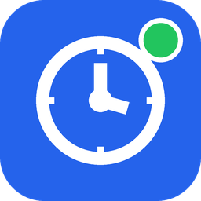
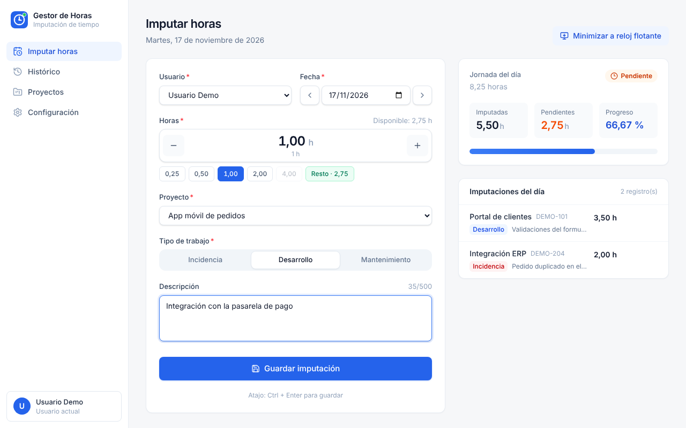
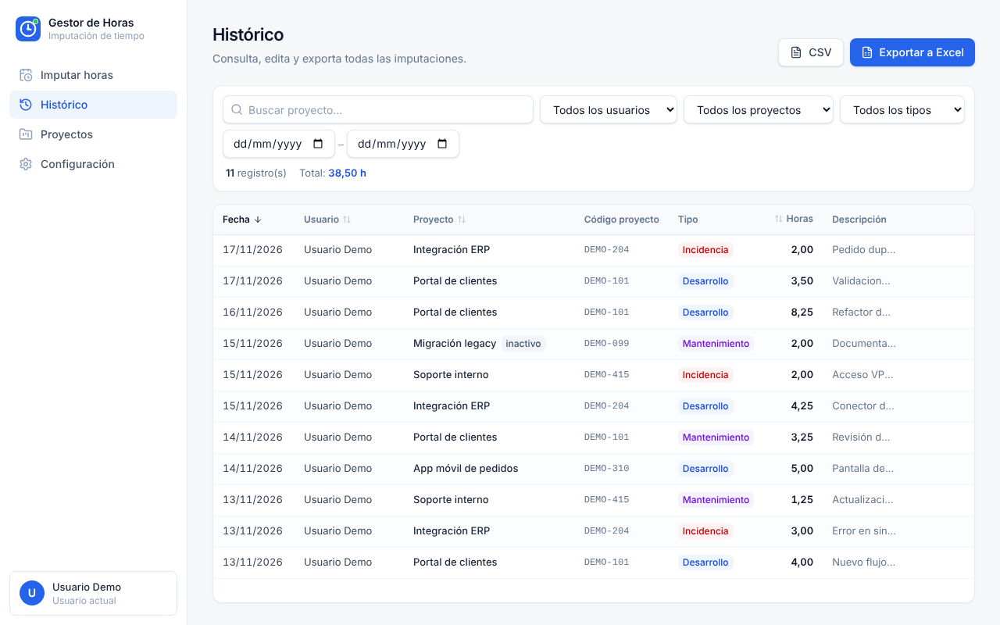
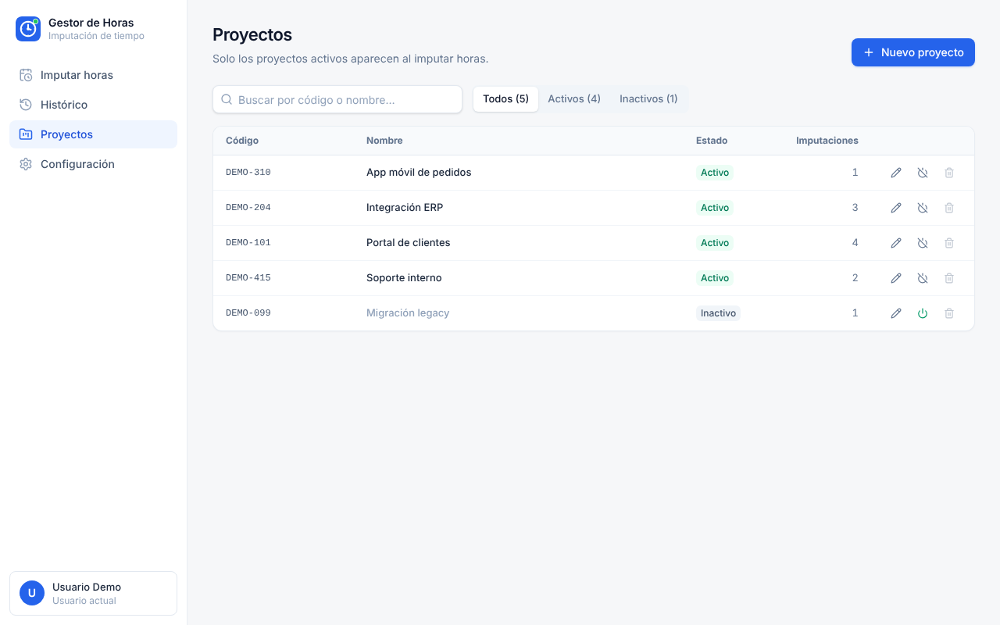
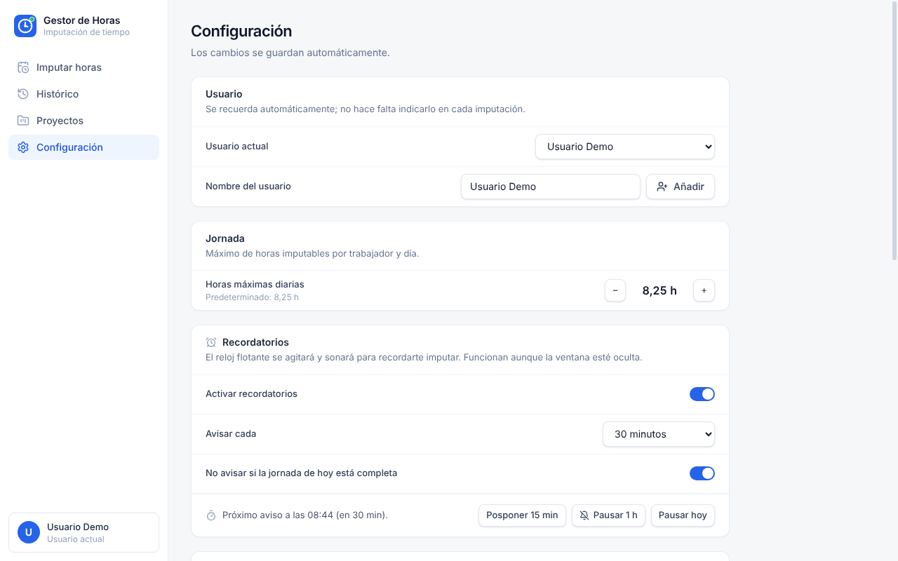
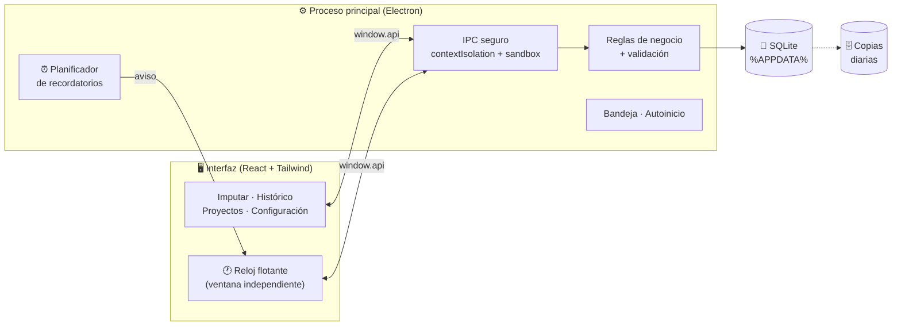

<div align="center">



# Gestor de Horas

### Imputa tus horas en segundos. Un pequeño reloj te recuerda el resto.

Aplicación de escritorio para Windows, **ligera, privada y 100 % local**, para registrar el tiempo que dedicas a cada proyecto.

<br />


<br />


<br />

[✨ Características](#-características) ·
[📸 Capturas](#-capturas) ·
[⬇️ Instalación](#️-instalación) ·
[📖 Guía de uso](#-guía-de-uso) ·
[🛠️ Desarrollo](#️-desarrollo) ·
[🏗️ Arquitectura](#️-arquitectura)

</div>

---



## ✨ Características

<table>
<tr>
<td width="50%" valign="top">

### ⏱️ Imputación ultrarrápida
Tramos de **15 minutos**, botones −/+, atajos rápidos y el botón **«Resto»**, que completa tu jornada con un clic. Guardas con <kbd>Ctrl</kbd> + <kbd>Enter</kbd>.

</td>
<td width="50%" valign="top">

### 📊 Tu jornada de un vistazo
Horas **imputadas**, **pendientes** y **% completado** con barra de progreso. Se pone en verde cuando terminas el día.

</td>
</tr>
<tr>
<td valign="top">

### 🕐 Reloj flotante
Una ventanita **siempre visible**, que puedes arrastrar adonde quieras y que deja pasar los clics a lo que hay debajo. Un anillo muestra tu progreso del día y con un clic vuelves a la app.

</td>
<td valign="top">

### 🔔 Recordatorios que no molestan
Cada 15, 30, 45, 60 o 90 min, o el intervalo que tú elijas, el reloj **se agita** y **suena** un aviso suave. Puedes posponerlos, pausarlos o dejar que se silencien solos cuando la jornada está completa.

</td>
</tr>
<tr>
<td valign="top">

### 🗂️ Histórico tipo Excel
Ordena, busca y filtra por usuario, proyecto, tipo y fechas, con el **total de horas** de lo que ves. Exporta a **Excel (.xlsx)** o **CSV** con un clic.

</td>
<td valign="top">

### 🔒 Tus datos, solo tuyos
Sin servidores, cuentas, nube ni telemetría. Todo se guarda en tu PC, con **copia de seguridad automática diaria** y exportación e importación para cambiar de equipo.

</td>
</tr>
</table>

## 📸 Capturas

<table>
<tr>
<td width="50%"><p align="center"><b>Histórico</b>: filtros, orden, totales y exportación</p></td>
<td width="50%"><p align="center"><b>Proyectos</b>: activos, inactivos y búsqueda</p></td>
</tr>
<tr>
<td width="50%"><p align="center"><b>Configuración</b>: jornada, avisos, sonido y copias</p></td>
<td width="50%" align="center">
<br />

&nbsp;&nbsp;&nbsp;&nbsp;

<p><b>Reloj flotante</b><br />en reposo (con el progreso del día) · <span>🟠</span> avisando</p>
<p>
<b>Clic</b> → abre la imputación<br />
<b>Arrastrar</b> → lo mueves (recuerda la posición)<br />
<b>Clic derecho</b> → posponer · pausar · salir
</p>
</td>
</tr>
</table>

## ⬇️ Instalación

> [!TIP]
> No necesitas instalar Node.js ni nada más. Basta con el instalador.

1. Descarga **`GestorHoras-Setup-x.y.z.exe`**, que se genera con `npm run dist` en la carpeta `release/`.
2. Ejecútalo. Si Windows SmartScreen muestra un aviso, pulsa **Más información → Ejecutar de todas formas** (el instalador no está firmado con un certificado de empresa).
3. Elige la carpeta de instalación. No hacen falta permisos de administrador.
4. Se crean accesos directos en el **escritorio** y en el **menú Inicio**. ¡Listo! 🎉

| | |
|---|---|
| 👥 **¿Para compañeros?** | Pásales el `.exe`. Cada instalación empieza vacía y es independiente. |
| 🔄 **¿Actualizar?** | Ejecuta el nuevo instalador encima. Tus datos **se conservan**. |
| 💾 **¿Dónde están mis datos?** | `%APPDATA%\Gestor de Horas\gestor-horas.sqlite`. No se borran al desinstalar. |

## 📖 Guía de uso

<details open>
<summary><b>🚀 Primer arranque</b></summary>
<br />

La app te pide tu nombre una sola vez y lo recuerda. Puedes cambiarlo o añadir más usuarios en **Configuración** o desde el selector de la pantalla de imputación. Después crea tus proyectos en **Proyectos** y ya puedes imputar.

</details>

<details>
<summary><b>⏱️ Imputar horas</b></summary>
<br />

| Campo | Cómo funciona |
|---|---|
| 👤 **Usuario** | Se recuerda automáticamente. |
| 📅 **Fecha** | Hoy por defecto. Con ◀ ▶ vas a otros días y **Hoy** te devuelve al actual. |
| ⏱️ **Horas** | Tramos de 0,25 h. Atajos 0,25 · 0,50 · 1 · 2 · 4 y **Resto**. |
| 📁 **Proyecto** | Solo proyectos activos; se muestra su nombre. |
| 🏷️ **Tipo** | 🔴 Incidencia · 🔵 Desarrollo · 🟣 Mantenimiento (obligatorio). |
| 📝 **Descripción** | Opcional, hasta 500 caracteres. |

Tras guardar se conservan el proyecto y el tipo, para que imputar varias tareas seguidas sea aún más rápido. En **Imputaciones del día** editas ✏️ o eliminas 🗑️ cualquier registro.

</details>

<details>
<summary><b>🕐 Reloj flotante y recordatorios</b></summary>
<br />

- **«Minimizar a reloj flotante»** oculta la ventana y deja el reloj sobre el escritorio.
- El anillo es azul mientras avanzas y se vuelve verde cuando completas la jornada.
- En cada aviso el reloj se agita y suena, y aparece un punto 🟠 que se queda hasta que lo pulsas.
- Los avisos funcionan **aunque la ventana esté oculta o minimizada**, y siguen tras suspender el equipo.
- Si minimizas o cierras la ventana, la app sigue en la **bandeja del sistema** junto al reloj de Windows.

</details>

<details>
<summary><b>🗂️ Histórico y exportación</b></summary>
<br />

- Columnas: Fecha · Usuario · Proyecto · Código · Tipo · Horas · Descripción.
- Para ordenar, pulsa la cabecera de Fecha, Usuario, Proyecto u Horas.
- Filtros por texto, usuario, proyecto, tipo y rango de fechas, con el **total** siempre visible.
- **Excel (.xlsx)** sale con fechas y horas numéricas, autofiltro y fila de total. **CSV** usa `;` y coma decimal, y se abre directo en Excel en español.
- Paginación de 50 filas para ir fluido con miles de registros.

</details>

<details>
<summary><b>💾 Copias de seguridad y cambio de ordenador</b></summary>
<br />

- **Automática**: una copia al día, que conserva las 10 últimas, en `%APPDATA%\Gestor de Horas\copias-seguridad`.
- **Exportar** guarda un `.sqlite` con todos tus datos.
- **Importar** restaura una copia. Antes guarda automáticamente lo que tenías, por si acaso.

**Cambiar de PC:** exporta en el equipo antiguo, instala la app en el nuevo e importa la copia. ✅

</details>

<details>
<summary><b>⚙️ Configuración disponible</b></summary>
<br />

Usuario · jornada máxima diaria (8,25 h por defecto) · intervalo de avisos · sonido y volumen · animación · posición del reloj · iniciar con Windows (arranca directamente como reloj) · bandeja del sistema · copias de seguridad · restaurar valores predeterminados.

</details>

### 📏 Reglas de negocio

| # | Regla |
|:-:|---|
| 1 | Mínimo **0,25 h** (15 min) por imputación y siempre **múltiplos de 15 min**. |
| 2 | Nunca se supera la **jornada máxima** (configurable) por usuario y día; la app te dice cuánto te queda. |
| 3 | Al **editar**, se descuenta el valor anterior del propio registro. |
| 4 | Los proyectos **inactivos** no se pueden elegir, pero se conservan en el histórico. |
| 5 | Los proyectos con imputaciones **no se borran**: se desactivan. |
| 6 | Se bloquea el **doble guardado accidental** de un registro idéntico. |
| 7 | Fechas guardadas en `AAAA-MM-DD` y mostradas en `DD/MM/AAAA`. |

> [!NOTE]
> Las horas se guardan internamente como **minutos enteros**, así que nunca hay errores de redondeo decimal (0,1 + 0,2 ≠ 0,3).

## 🛠️ Desarrollo

```bash
npm install     # 📦 instala dependencias (requiere Node.js 20+)
npm run dev     # 🔥 modo desarrollo (F12 abre DevTools)
npm test        # 🧪 46 pruebas unitarias y de integración (Vitest)
npm run build   # 🏗️ compila la interfaz y el proceso principal
npm run dist    # 📦 genera release/GestorHoras-Setup-x.y.z.exe
```

<details>
<summary><b>🧪 Pruebas end-to-end</b></summary>
<br />

`tests/e2e/run.mjs` arranca la **aplicación Electron real** y recorre 13 escenarios: primer uso, proyectos, imputación, límites, edición, histórico, configuración, reloj flotante, **recordatorio real por temporizador con la ventana oculta**, arrastre, restauración, bandeja y persistencia tras reiniciar.

```bash
npm run build
node tests/e2e/run.mjs                    # Windows / macOS
xvfb-run -a sh tests/e2e/xvfb-run.sh      # Linux sin pantalla
```

Las capturas de este README se generan con datos ficticios mediante `node scripts/screenshots.mjs`.

</details>

<details>
<summary><b>🚢 Publicar una nueva versión</b></summary>
<br />

1. Sube la versión en `package.json`, por ejemplo `"version": "1.1.0"`.
2. Ejecuta `npm test` y comprueba que todo está ✅.
3. Ejecuta `npm run dist`. En Windows funciona tal cual; en Linux o macOS hace falta Wine para incrustar el icono.
4. Reparte `release/GestorHoras-Setup-1.1.0.exe`. Si se instala encima, los datos se conservan.

**¿Cambios en la base de datos?** Añade una entrada nueva al final de `MIGRATIONS` en `electron/db.ts` (nunca edites una existente). Se aplica sola al arrancar y al importar copias antiguas.

</details>

## 🏗️ Arquitectura



```
electron/        ⚙️  Proceso principal: ventanas, reloj, bandeja, IPC, SQLite, reglas, avisos, copias
shared/          🤝  Tipos, reglas y validaciones comunes a interfaz y backend
src/             🎨  Interfaz React: páginas, componentes y la ventana del reloj flotante
tests/           🧪  Vitest (unitarias/integración) + E2E con Playwright sobre Electron
scripts/         🔧  Compilación, modo desarrollo, iconos y capturas
build/           📦  Iconos e instalador
docs/            📸  Capturas del README
```

<details>
<summary><b>💡 Decisiones técnicas</b></summary>
<br />

- **sql.js (SQLite en WebAssembly)** en lugar de un módulo nativo. No hay que compilar nada para cada versión de Windows o Electron, y el instalador funciona en cualquier PC. Cada cambio se escribe a disco de forma **atómica** (fichero temporal y renombrado, con reintentos), así que un cierre inesperado nunca corrompe los datos.
- **Seguridad**: `contextIsolation` y `sandbox` activados, `nodeIntegration` desactivado, CSP estricta, navegación bloqueada y verificación del origen de cada llamada IPC.
- **Recordatorios en el proceso principal**, que revisa como mucho cada minuto. Así funcionan con la interfaz oculta y se recuperan tras suspender el equipo.
- **Sonido sintetizado con Web Audio**: no hay ficheros de audio y respeta el volumen configurado.
- **Errores registrados** en `%APPDATA%\Gestor de Horas\logs\app.log`, con rotación al llegar a 1 MB.

</details>

---

<div align="center">

Hecho con ☕ y ⏱️ para dejar de pelearse con el registro de horas.

<sub>Uso interno · Funciona sin conexión · Tus datos nunca salen de tu ordenador</sub>

</div>
